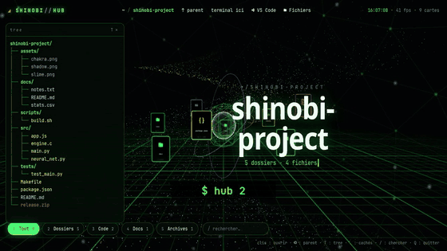

# Geek Hub 3D

Un dashboard 3D (Three.js) lancé depuis le terminal Linux : ta galerie de fonds d'écran et **tes fichiers** deviennent des cartes qui flottent en orbite, au milieu de particules et d'une grille cyber.



▶ Vidéo complète : [docs/demo.mp4](docs/demo.mp4)

## Deux modes

| Commande | Ce que ça fait |
|---|---|
| `hub` | **Galerie** : les images de `~/Downloads/Wallpaper`, classées en Animé / Gaming / IA-Tech selon leur nom |
| `hub 2` | **Explorateur de fichiers 3D** du dossier où tu es dans le terminal (`hub 2 ~/Projet` pour un autre dossier) |

Dans l'explorateur :
- clic sur un **dossier** → tu entres dedans ;
- clic sur un **fichier** → zoom + aperçu du texte, avec les boutons **Ouvrir**, **Terminal** (Kitty dans ce dossier), **VS Code** et **Copier le chemin** ;
- panneau **tree** à gauche (`T`), cliquable comme la commande `tree` ;
- `⌫` dossier parent · `.` fichiers cachés · `/` recherche · `Q` quitter.

`fetch-walls -s "naruto" 5` télécharge des fonds d'écran (API publique Wallhaven, animé, SFW), puis `hub --rebuild` les ajoute à la galerie.

## Installation

```bash
git clone https://github.com/Sotinkon/geek-hub-3d.git
cd geek-hub-3d
./install.sh
source ~/.bashrc
hub 2
```

Prérequis : Linux, `python3` + Pillow (`sudo apt install python3-pil`), un navigateur Chromium (Chrome, Chromium ou Brave). Kitty et VS Code sont optionnels : ils servent seulement aux boutons Terminal et VS Code. Le premier lancement a besoin d'internet pour charger Three.js depuis jsDelivr.

`extras/kitty.conf` contient le thème de terminal utilisé dans la démo (noir mat opaque, texte vert).

## Comment ça marche

```
hub / hub 2 ─► bin/hub (lancé en arrière-plan, une fenêtre par mode)
                 └► bin/geek-hub.py
                      · serveur local sur 127.0.0.1, port aléatoire
                      · Chrome --app avec un profil séparé (~/.cache/geek-hub/)
                      · fenêtre fermée → navigateur et serveur s'arrêtent
web/  index.html · style.css · app.js (scène 3D) · files.js (explorateur)
```

- **Performance** : l'animation s'arrête complètement quand la fenêtre perd le focus (0 % CPU/GPU). La résolution de rendu est plafonnée à 1,5×, les particules sont animées sur le GPU et les images sont réduites en miniatures.
- **Sécurité de l'explorateur** :
  - il lit uniquement ton dossier personnel et ne peut rien modifier ni supprimer ;
  - chaque requête doit porter un jeton secret créé à chaque lancement, et l'en-tête `Host` est vérifié, donc un autre site ouvert dans ton navigateur ne peut pas s'en servir ;
  - « Ouvrir » refuse ce qui peut lancer un programme (`.desktop`, AppImage, binaires exécutables).
- **Tes profils de navigateur ne sont jamais touchés.**

## Licence

MIT, voir [LICENSE](LICENSE).
